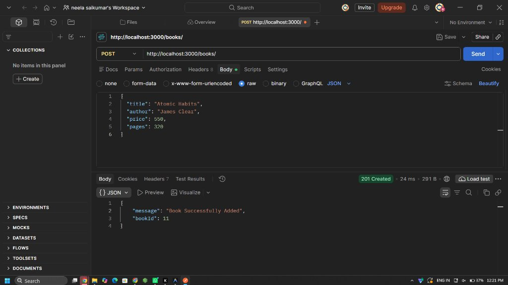

# Lab 2: Books CRUD API Using Node.js, Express, and SQLite

## Student Details

- **Name:** Neela Sai Kumar
- **Registration Number:** 252U1R9108
- **Section:** CSE-GEN AI -2B
- **Course:** Backend Development Fundamentals (Year II Term II &middot; Aurora)
- **Faculty:** Joel Prashanth D
- **Lab Number:** 02

---

## Live Deployment

- **Platform:** Render (Web Service)
- **Deployment URL:** https://bdf-labs-yewg.onrender.com/
- **Live Endpoints:**
  - Status Check: https://bdf-labs-yewg.onrender.com/
  - GET All Books: https://bdf-labs-yewg.onrender.com/books/
  - GET Book by ID: https://bdf-labs-yewg.onrender.com/books/3/

---

## Objective

To develop a RESTful Books API using Node.js, Express.js, and SQLite to perform CRUD (Create, Read, Update, and Delete) operations on book records using parameterized queries with `?` placeholders.

---

## Technologies Used

- Node.js (Runtime)
- Express.js (Web Framework)
- SQLite3 & sqlite (Relational Database)
- JavaScript
- npm
- Postman
- Visual Studio Code
- Git & GitHub

---

## Project Structure

```text
Lab-02/
├── screenshorts/
│   ├── DELETE.png
│   ├── ERROR.png
│   ├── GETONE.png
│   ├── GET_ALL .png
│   ├── GET_ALL.png
│   ├── POST.png
│   └── PUT.png
├── .gitignore
├── app.js
├── books.SQL
├── books.db
├── package.json
├── package-lock.json
└── README.md
```

---

## Database Schema & Initial Seed Records

### Schema

```sql
CREATE TABLE IF NOT EXISTS book (
  id INTEGER PRIMARY KEY AUTOINCREMENT,
  title TEXT NOT NULL,
  author TEXT NOT NULL,
  price INTEGER NOT NULL,
  pages INTEGER NOT NULL
);
```

### Initial Seed Records (10 Books)

| ID | Title | Author | Price (₹) | Pages |
|---|---|---|---|---|
| 1 | Wings of Fire | A.P.J. Abdul Kalam | 250 | 180 |
| 2 | The Alchemist | Paulo Coelho | 300 | 208 |
| 3 | Atomic Habits | James Clear | 450 | 320 |
| 4 | Ikigai | Hector Garcia | 350 | 194 |
| 5 | Rich Dad Poor Dad | Robert Kiyosaki | 400 | 336 |
| 6 | The Power of Habit | Charles Duhigg | 420 | 371 |
| 7 | Deep Work | Cal Newport | 380 | 296 |
| 8 | Think Like a Monk | Jay Shetty | 399 | 288 |
| 9 | The Psychology of Money | Morgan Housel | 350 | 256 |
| 10 | The 5 AM Club | Robin Sharma | 450 | 336 |

---

## Installation and Setup

### Prerequisites

- **Node.js** (v18 or higher)
- **npm** (Package Manager)
- **Postman** (API Testing)

### Steps to Run

1. Open the terminal and navigate to `Lab-02`:

   ```bash
   cd Lab-02
   ```

2. Install dependencies:

   ```bash
   npm install
   ```

3. Start the server with automatic reloading:

   ```bash
   npm run dev
   ```

   Or run directly with Node.js:

   ```bash
   npm start
   ```

4. The server runs at:

   `http://localhost:3000`

---

## API Endpoints

| Method | Endpoint | Description | Expected Status |
|---|---|---|---|
| GET | `/` | Returns API status message | 200 OK |
| GET | `/books/` | Retrieves all books ordered by ID | 200 OK |
| GET | `/books/:bookId/` | Retrieves a specific book by ID | 200 OK / 404 Not Found |
| POST | `/books/` | Adds a new book to the database | 201 Created / 400 Bad Request |
| PUT | `/books/:bookId/` | Updates an existing book | 200 OK / 404 Not Found |
| DELETE | `/books/:bookId/` | Deletes a book using its ID | 200 OK / 404 Not Found |

---

## Screenshots

### 1. GET All Books (`GET_ALL.png`)

Postman request to `GET http://localhost:3000/books/` returning HTTP status `200 OK` and a JSON array of all initial books.


- [View Screenshot (screenshorts/GET_ALL.png)](screenshorts/GET_ALL.png)

---

### 2. GET Single Book by ID (`GETONE.png`)

Postman request to `GET http://localhost:3000/books/3/` returning HTTP status `200 OK` with the book details for ID 3.


- [View Screenshot (screenshorts/GETONE.png)](screenshorts/GETONE.png)

---

### 3. POST Add New Book (`POST.png`)

Postman request to `POST http://localhost:3000/books/` with JSON payload, returning HTTP status `201 Created`.


- [View Screenshot (screenshorts/POST.png)](screenshorts/POST.png)

---

### 4. PUT Update Book Details (`PUT.png`)

Postman request to `PUT http://localhost:3000/books/1/` updating title, price, and pages, returning HTTP status `200 OK`.


- [View Screenshot (screenshorts/PUT.png)](screenshorts/PUT.png)

---

### 5. DELETE Book by ID (`DELETE.png`)

Postman request to `DELETE http://localhost:3000/books/2/` removing book #2, returning HTTP status `200 OK`.


- [View Screenshot (screenshorts/DELETE.png)](screenshorts/DELETE.png)

---

### 6. Error Handling - Book Not Found (`ERROR.png`)

Postman request to `DELETE http://localhost:3000/books/999/` returning HTTP status `404 Not Found` with `{ "error": "Book not found" }`.


- [View Screenshot (screenshorts/ERROR.png)](screenshorts/ERROR.png)

---

### 7. GET ALL Books After CRUD Operations (`GET_ALL .png`)

Postman request to `GET http://localhost:3000/books/` after CRUD modifications, confirming book updates and deletions.


- [View Screenshot (screenshorts/GET_ALL .png)](screenshorts/GET_ALL%20.png)

---

## Viva Questions & Answers

### 1. Why await the database call?
> **Answer:** Database operations (`db.all()`, `db.get()`, `db.run()`) perform asynchronous I/O across the filesystem. Awaiting the database call ensures the asynchronous Promise resolves before the next line of code executes, preventing `undefined` responses from being sent back to the client while keeping Node's event loop non-blocking for other concurrent requests.

### 2. What is SQL injection and how do placeholders prevent it?
> **Answer:** SQL injection occurs when untrusted user input is directly concatenated into SQL query strings, allowing attackers to manipulate queries (e.g. `1 OR 1=1`). Placeholders (`?`) ensure that user inputs are treated strictly as literal data values rather than executable SQL syntax, completely neutralizing injection vulnerabilities.

### 3. When is PUT used instead of POST?
> **Answer:** POST is used to create new resources and is **not idempotent** (multiple requests create multiple records). PUT is used to update or replace an existing resource identified by a specific URI and is **idempotent** (repeated identical PUT requests result in the same server state).

---

## Conclusion

The Books CRUD API was developed using Node.js, Express.js, and SQLite (`sqlite3@5.1.7` & `sqlite@5.1.1`). It supports creating, retrieving, updating, and deleting book records with parameterized queries, and all endpoints were verified with Postman.
