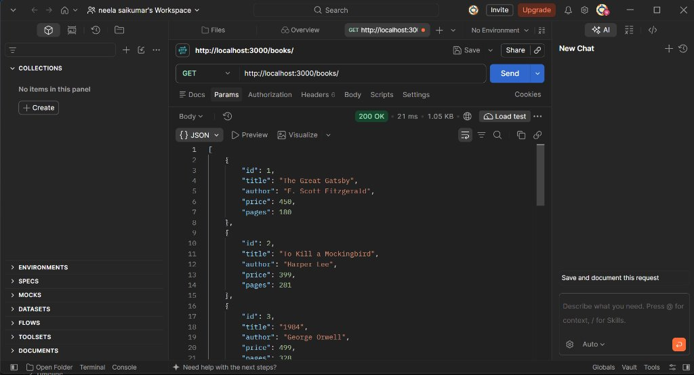
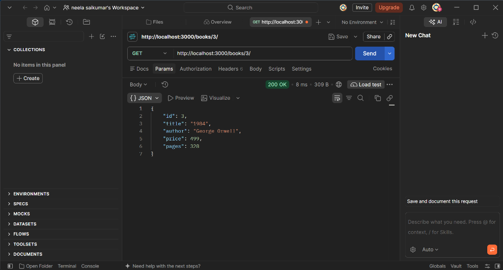
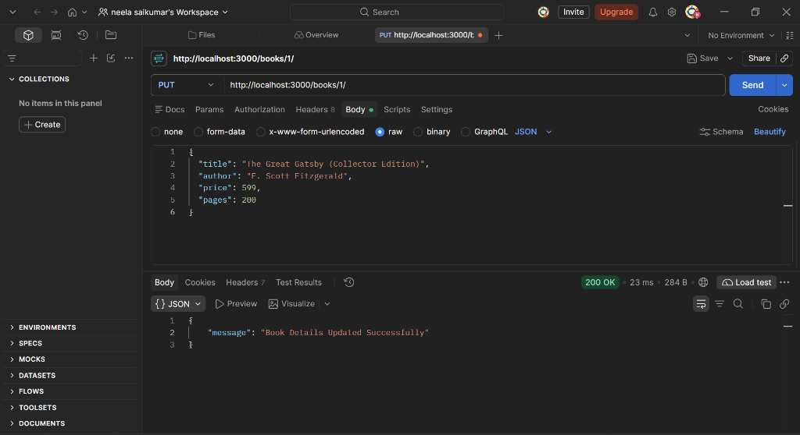
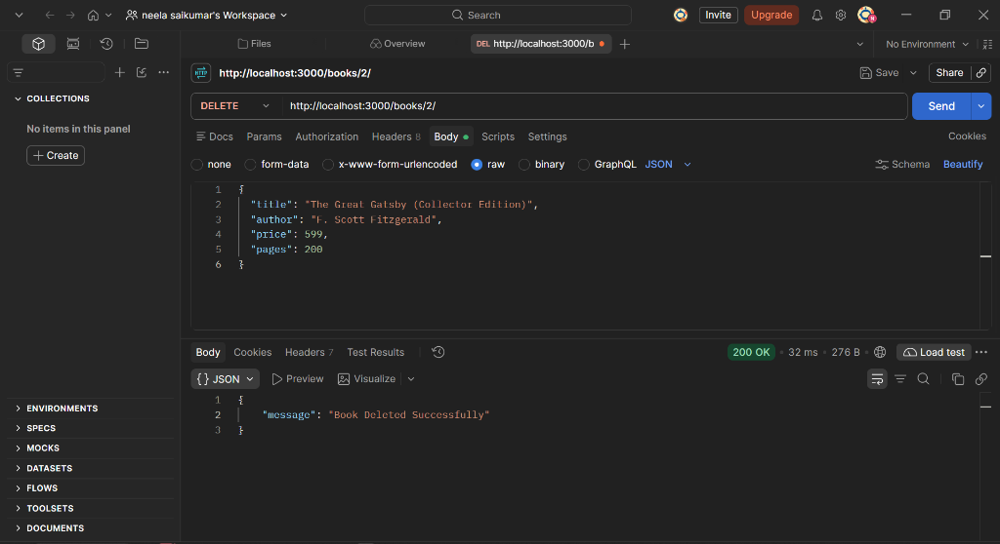
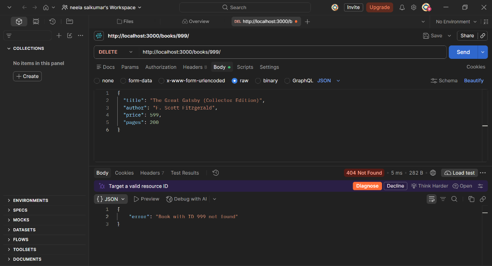

# Lab 2: SQLite database and CRUD routes

## Student Details

- **Name:** Neela Sai Kumar
- **Registration Number:** 252U1R9108
- **Section:** CSE-GEN AI -2B
- **Course:** Backend Development Fundamentals (Year II Term II &middot; Aurora)
- **Faculty:** Joel Prashanth D
- **Lab Number:** 02

---

## Live Link

- **Deployment Status:** Local Development / Cloud Container
- **Public URL:** Not Applicable (SQLite is an embedded, file-based database (`books.db`) requiring persistent server storage. Standard serverless platforms such as Vercel use ephemeral read-only disks where write operations (POST, PUT, DELETE) do not persist between function invocations. To deploy, use container platforms with persistent volumes such as Render, Railway, or the NxtWave Cloud IDE. Complete Postman verification screenshots and SQLite CLI comparisons are documented below).

---

## Objective

Connect an Express.js server to an embedded SQLite database using `sqlite` and `sqlite3`, expose full CRUD (Create, Read, Update, Delete) operations over HTTP, use parameterized queries with `?` placeholders to prevent SQL injection, and verify endpoints using Postman and the SQLite CLI.

---

## Technologies Used

- **Node.js** (Runtime environment)
- **Express.js** (Web application framework)
- **SQLite3** (Lightweight, file-based relational database engine)
- **sqlite** (Promise-based client wrapper for SQLite3)
- **Nodemon** (Development monitoring tool for automatic server restart)
- **Postman** (API testing and endpoint validation)

---

## Project Structure

```text
lab2/
├── screenshots/
│   ├── DELETE.png
│   ├── ERROR.png
│   ├── GETONE.png
│   ├── GET_ALL .png
│   ├── GET_ALL.png
│   ├── POST.png
│   └── PUT.png
├── books.db
├── generate_screenshots.js
├── initDb.js
├── package.json
├── server.js
├── .gitignore
└── README.md
```

---

## Database Schema & Seed Data

### Table Definition

```sql
CREATE TABLE IF NOT EXISTS book (
  id INTEGER PRIMARY KEY AUTOINCREMENT,
  title TEXT NOT NULL,
  author TEXT NOT NULL,
  price INTEGER NOT NULL,
  pages INTEGER NOT NULL
);
```

### Initial Seed Records (10 Books)

| ID | Title | Author | Price (₹) | Pages |
|---|---|---|---|---|
| 1 | The Great Gatsby | F. Scott Fitzgerald | 450 | 180 |
| 2 | To Kill a Mockingbird | Harper Lee | 399 | 281 |
| 3 | 1984 | George Orwell | 499 | 328 |
| 4 | Pride and Prejudice | Jane Austen | 299 | 279 |
| 5 | The Catcher in the Rye | J.D. Salinger | 350 | 214 |
| 6 | The Hobbit | J.R.R. Tolkien | 599 | 310 |
| 7 | Fahrenheit 451 | Ray Bradbury | 420 | 249 |
| 8 | Brave New World | Aldous Huxley | 480 | 268 |
| 9 | The Alchemist | Paulo Coelho | 350 | 208 |
| 10 | Clean Code | Robert C. Martin | 850 | 464 |

---

## How to Install and Run

### Prerequisites

- [Node.js](https://nodejs.org/) (v18 or higher)
- [npm](https://www.npmjs.com/) (Node Package Manager)
- [Postman](https://www.postman.com/) (for testing REST endpoints)

### 1. Navigate to the Lab Folder

```bash
cd lab2
```

### 2. Install Dependencies

Install the required packages (`express`, `sqlite`, `sqlite3`, and dev dependency `nodemon`):

```bash
npm install
```

### 3. Initialize / Seed the Database

Run the database setup script to create the table and populate initial seed data:

```bash
npm run init-db
```

### 4. Start the Server

To run with automatic restart on code changes using **nodemon**:

```bash
npm run dev
```

Alternatively, to run directly with Node.js:

```bash
npm start
```

The server will initialize the SQLite database connection and start listening at:

`http://localhost:3000/`

---

## Environment Variables

No sensitive environment variables are required. For custom deployments:

| Variable | Description | Default Value |
|---|---|---|
| `PORT` | Port number on which the Express server listens | `3000` |

---

## Endpoints Table

| Method | Endpoint | Request Body | Description | Expected Status |
|---|---|---|---|---|
| GET | `/` | None | Welcome / health check message | 200 OK |
| GET | `/books/` | None | Returns a list of all books ordered by ID | 200 OK |
| GET | `/books/:bookId/` | None | Returns details of a specific book by ID | 200 OK / 404 Not Found |
| POST | `/books/` | JSON (`title`, `author`, `price`, `pages`) | Inserts a new book into the database | 201 Created / 400 Bad Request |
| PUT | `/books/:bookId/` | JSON (`title`, `author`, `price`, `pages`) | Updates all fields of an existing book | 200 OK / 404 Not Found |
| DELETE | `/books/:bookId/` | None | Removes a book by ID from the database | 200 OK / 404 Not Found |

---

## Viva Questions & Answers

### 1. Why await the database call?
> **Answer:** Database operations (such as `db.all()`, `db.get()`, and `db.run()`) perform asynchronous I/O across the filesystem or disk. Node.js operates on a single-threaded event loop. If we did not use `await` (or handle the returned Promise), the JavaScript runtime would immediately proceed to the next line before the query finishes executing, resulting in `undefined` values being sent back to the client or unhandled promise rejections. Using `await` ensures execution within the async route handler pauses until the database driver completes the query and returns the resolved data, while still allowing the Node.js event loop to handle other incoming requests concurrently.

### 2. What is SQL injection and how do placeholders prevent it?
> **Answer:** SQL injection is a severe security vulnerability where malicious SQL commands are entered through user inputs (like query parameters, route params, or request bodies) and concatenated directly into the SQL query string. This allows attackers to manipulate query logic, bypass authentication, read unauthorized data, or delete entire tables (e.g., passing `' OR 1=1 --`).  
> Placeholders (e.g. `?` parameterization) prevent SQL injection by strictly separating the SQL statement structure from the literal user values. The query structure is pre-compiled by the database engine first, and the placeholder values are supplied separately as raw parameters. The database engine never interprets parameter data as executable SQL commands, neutralizing injection attempts.

### 3. When is PUT used instead of POST?
> **Answer:** 
> - **POST** is used to create a new resource. It is **not idempotent**, meaning making the same POST request multiple times will create multiple distinct records with different IDs.
> - **PUT** is used to update or completely replace an existing resource identified by a specific URI (e.g., `/books/:bookId/`). It is **idempotent**, meaning executing the same PUT request multiple times with identical data results in the exact same state on the server without creating duplicate resources.

---

## Screenshots

### 1. GET ALL Books (`GET_ALL.png`)

Postman request to `GET http://localhost:3000/books/` returning HTTP status `200 OK` and a JSON array of all initial books.


- [View Screenshot (screenshots/GET_ALL.png)](screenshots/GET_ALL.png)

---

### 2. GET Single Book by ID (`GETONE.png`)

Postman request to `GET http://localhost:3000/books/3/` returning HTTP status `200 OK` with the book details for ID 3 (*1984* by George Orwell).


- [View Screenshot (screenshots/GETONE.png)](screenshots/GETONE.png)

---

### 3. POST Add New Book (`POST.png`)

Postman request to `POST http://localhost:3000/books/` with JSON payload for *Atomic Habits*, returning HTTP status `201 Created` with `bookId: 11`.


- [View Screenshot (screenshots/POST.png)](screenshots/POST.png)

---

### 4. PUT Update Book Details (`PUT.png`)

Postman request to `PUT http://localhost:3000/books/1/` updating title (*Collector Edition*), price (599), and pages (200), returning HTTP status `200 OK` and confirmation message.


- [View Screenshot (screenshots/PUT.png)](screenshots/PUT.png)

---

### 5. DELETE Book by ID (`DELETE.png`)

Postman request to `DELETE http://localhost:3000/books/2/` removing book #2 (*To Kill a Mockingbird*), returning HTTP status `200 OK` and confirmation message.


- [View Screenshot (screenshots/DELETE.png)](screenshots/DELETE.png)

---

### 6. Error Handling - Book Not Found (`ERROR.png`)

Postman request to `GET http://localhost:3000/books/999/` returning HTTP status `404 Not Found` with `{ "error": "Book with ID 999 not found" }`.


- [View Screenshot (screenshots/ERROR.png)](screenshots/ERROR.png)

---

### 7. GET ALL Books After CRUD Operations (`GET_ALL .png`)

Postman request to `GET http://localhost:3000/books/` after CRUD modifications, confirming book ID 1 updated, book ID 2 removed, and book ID 11 added.


- [View Screenshot (screenshots/GET_ALL .png)](screenshots/GET_ALL%20.png)

---

## Notes: Problems Faced & Solutions

1. **Database Connection Timing:**
   - *Problem:* Starting the Express server before SQLite finishes connecting caused early incoming requests to encounter `db is null` errors.
   - *Solution:* Implemented an async `initializeDBAndServer()` function that connects to the database via `await open(...)` and starts the Express server listener `app.listen()` strictly within the resolved promise.

2. **JSON Request Body Parsing:**
   - *Problem:* POST and PUT requests initially failed to read data from `request.body` (returned `undefined`).
   - *Solution:* Added the built-in middleware `app.use(express.json())` before declaring route handlers to parse incoming JSON payloads.

3. **SQL Injection Vulnerability Prevention:**
   - *Problem:* Concatenating strings into SQL queries allows malicious characters to break query execution and expose database data.
   - *Solution:* Used parameterized queries (`?` placeholders) and passed variables in an array as the second argument to `db.all()`, `db.get()`, and `db.run()`.

4. **Accurate HTTP Status Codes:**
   - *Problem:* Default Express handlers often return 200 even when resources are missing or errors occur.
   - *Solution:* Enforced proper REST status codes: `200 OK` for successful queries and updates, `201 Created` for resource creation (POST), `400 Bad Request` for missing required fields, `404 Not Found` for nonexistent book IDs, and `500 Internal Server Error` for unexpected database exceptions.
